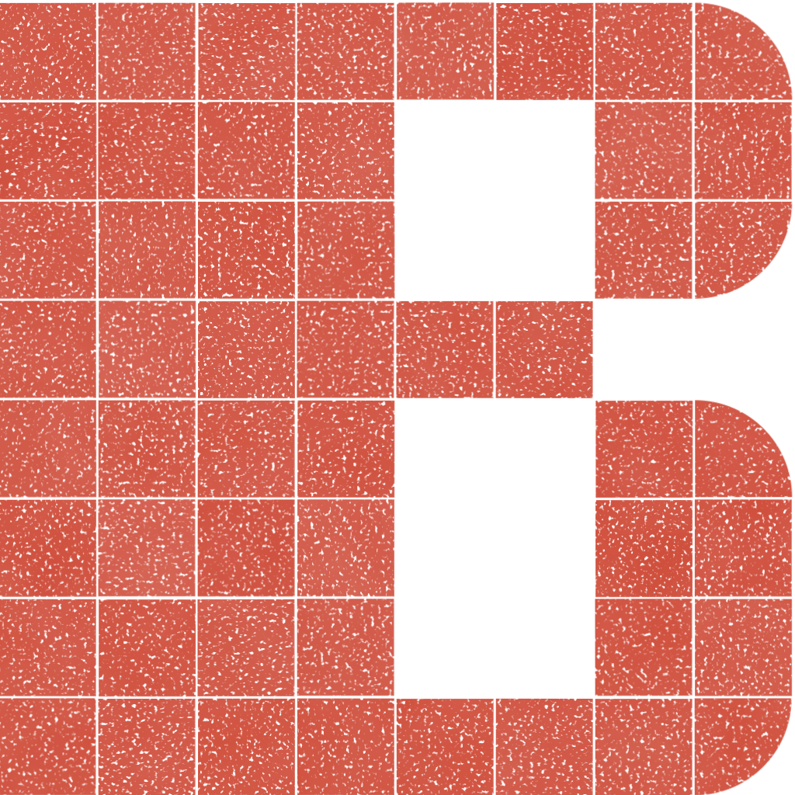

<p align="center">
  
</p>

<h1 align="center">Brickpress</h1>

<p align="center">A local studio for brick compositions and simulated letterpress prints.</p>

<p align="center">
  <a href="docs/architecture.md">Architecture</a> ·
  <a href="docs/mcp.md">Agents (MCP)</a> ·
  <a href="https://github.com/Aqualy/Brickpress/issues">Feedback</a>
</p>

Brickpress 2 is a native desktop application for Windows, macOS and Linux,
written in Rust (eframe, egui and wgpu). It has no accounts and no remote
backend. It replaces the 1.x SvelteKit/Tauri editor. Projects, presets,
preferences and recovery data from 1.x open unchanged.

## Build and run

Install a current stable Rust toolchain (1.90 or newer), then:

```sh
cargo run -p brickpress-app --release
```

On Linux, install the windowing development packages first, for example
`libxkbcommon-dev libwayland-dev libx11-dev libxcursor-dev libxi-dev libxrandr-dev`.
Installers for 2.0 are not published yet. The
[1.1.0 test release](https://github.com/Aqualy/Brickpress/releases/tag/v1.1.0)
remains available.

## Working in the studio

- **Pieces:** choose a shape in the Library, press **B** (Place) and click or
  drag on the board. A drag fills every cell along the path. **R** rotates.
  **V** selects, **H** or Space-drag pans, and the wheel zooms at the pointer.
  **Esc** cancels placing, a stroke or the selection.
- **Inks:** each colour is an ink pass. Passes print in order and overprint
  each other.
- **Presets:** save the board or a selection as a preset. You can place it in
  the current project, or open it as a new project of its own.
- **Tabs:** several projects can be open at once. **Ctrl/⌘ W** closes a tab and
  **Ctrl+Tab** switches. Unsaved tabs are recovered after a crash.
- **Print:** shows the simulated letterpress impression. Eleven press controls
  and six presets set ink, pressure, wear, paper tooth and registration. The
  simulation is seeded, so a project prints the same way every time.
- **3D:** shows and edits the board as raised pieces on a studded baseplate.
- **Export:** PNG up to 12,000 px per side, and SVG. Design SVGs are pure
  vector. Print SVGs keep the vector pieces.
- **Commands:** every command, with its shortcut, is in the menus and the
  command palette (**Ctrl/⌘ K**).

Projects are version-1 `.brickpress.json` files. Legacy `.legopress.json`
files also open. Tracing images (PNG, JPEG, WebP, GIF or BMP, up to 20 MB and
40 megapixels) stay on your device and are never part of a project or an
export.

## Agents

`brickpress mcp` is a Model Context Protocol server. It lets an agent such as
Claude compose boards, render previews, and save or export the result.
`brickpress mcp --live` drives the open window instead, after you allow it in
Help ▸ Allow Agent Connections. See [docs/mcp.md](docs/mcp.md).

## Development

```sh
cargo test --workspace     # unit, 1.x parity, GPU render, UI and MCP tests
cargo fmt --all && cargo clippy --workspace --all-targets -- -D warnings
```

See [docs/architecture.md](docs/architecture.md) for the crate layout, the
renderer and the tests.

## Licence and notices

Brickpress is independent software. LEGO® is a trademark of the LEGO Group,
which does not sponsor, authorize or endorse Brickpress. Product references
identify compatible geometry; they do not grant trademark, design or copyright
rights. See [NOTICE.md](NOTICE.md) for attribution and release considerations.

The original Brickpress code and catalog are licensed under the
[Anti-Capitalist Software License v1.4](LICENSE), copyright 2026 Tiebo (Aqualy).
ACSL restricts permitted users and organizations, and it is not an open-source
licence under the usual definition; see
[its authors' explanation](https://anticapitalist.software/). Third-party code,
fonts and icons keep their own licences. Their notices are in
`crates/brickpress-app/assets/THIRD_PARTY_NOTICES.txt`, which is bundled in the
application (Help ▸ Third-Party Notices).
